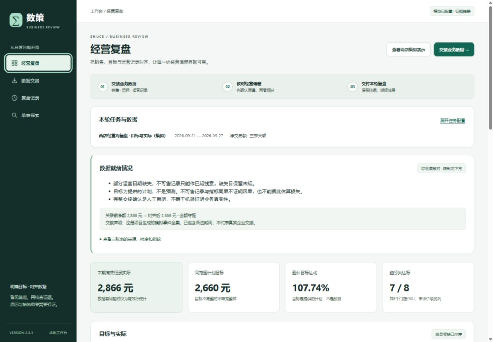

# 数策 · 可复核的经营分析工作台

把销售明细、经营目标与日运营记录，整理成有口径、有证据、可交接的门店经营复盘。

**v2.5.0 · Windows / Python 3.12 · FastAPI / pandas / SQLite / 原生 JavaScript**

面向本地经营复盘与业务分析演示，使用 AI 辅助开发。演示数据全部由项目生成；公开证据区分工程测试、历史界面检查与真实业务验证。

## 先看成果



*历史界面截图：2026-10-20、v2.3.1、模拟业务；不是本轮实时模型结果或新的浏览器验收。当前发布版新增错误恢复、重复保存保护与可复现评测，保留原有布局。*

无需安装：下载仓库或 [Release 交付包](https://github.com/abalika/shuce-business-analytics/releases)，打开 `outputs/offline-demo-v2.5.0/index.html`。里面有独立 HTML 报告、Excel、JSON、三张源表和三类证据 CSV。它们明确标注“预置演示数据 / 非实时”，静态报告不会重新计算。

## 解决什么问题

门店负责人看到“本周达标了吗”，经常先遇到不同表的口径、时间与粒度不一致。数策先核对这些前提，再算差异，而不是让模型直接猜一个原因。

| 业务步骤 | 工程处理 | 可交付结果 |
| --- | --- | --- |
| 销售、目标、运营三表交接 | 字段映射、重复/缺失诊断、期间与粒度核对 | 来源原件、质量提示、SHA256 |
| 确认统计口径与交接完整性 | 缺记录不自动视为零、目标不按天重复分摊 | 可计算/不可评价状态与理由 |
| 找到门店、SKU 偏差 | 金额逐行舍入到分后汇总；独立 SQL 对照 | 目标/实际、分类缺口、三源证据 |
| 形成判断并交接 | 分开事实、假设、核查计划；保存不可变版本 | HTML / 三工作表 Excel / JSON |
| 查看下一周期 | 关联前次报告并校验期间与指标 | 前后变化与后续核查线索 |

模拟案例控制数：**净交易额 2866 元 / 目标 2660 元，8 组中 7 组达标**。南门拿铁 312 / 500 元，缺口 188 元。运营记录缺日、不可售分钟只是核查线索，不能自动推断损失或因果。净交易额不等于利润。

## 5 分钟启动

先安装 Python 3.12，并在项目根目录运行：

```powershell
powershell -NoProfile -ExecutionPolicy Bypass -File scripts/setup.ps1
powershell -NoProfile -ExecutionPolicy Bypass -File scripts/launch.ps1 -Offline
```

访问 `http://127.0.0.1:8765`，点击“两店完整演示”。停止：

```powershell
powershell -NoProfile -ExecutionPolicy Bypass -File scripts/stop.ps1
```

首次安装需要包下载网络或预备好的 wheels；之后离线模式无须模型网关。前端不需要 npm 构建。启动器检查端口、数据完整性、服务身份并在冷启动前备份。仅停止经身份核对的本项目进程，不管理外部模型服务。

## AI 在哪里

`/explore` 的自然语言问数会被转换为受限工具参数；代码负责实际计算。AI 证据摘要需结构与引用校验，仍不能证明解释或因果成立。

普通模式可按 `.env.example` 配置兼容 Chat Completions 的服务；密钥只在后端。离线模式强制忽略全部模型配置，明确显示规则计算，不返回伪造 AI 输出。未配置、超时、限流、认证失败均有明确状态与恢复路径。

## 可复现验证

安装 Node.js 后运行一条命令：

```powershell
.venv\Scripts\python.exe scripts/evaluate.py --out outputs/my-acceptance
```

执行 Python 回归、JS 草稿/错误反馈与语法检查、离线业务全流程、原始 CSV 到独立 SQL 的 8 组核对，以及备份校验和新目录恢复。失败返回非零退出码，旧证据不会覆盖。

固定 20 题评测可单独运行：

```powershell
.venv\Scripts\python.exe scripts/benchmark.py --out outputs/benchmark-first.json
.venv\Scripts\python.exe scripts/benchmark.py --out outputs/benchmark-next.json --previous outputs/benchmark-first.json
```

题集与断言执行器均记录 SHA256。输出通过率、失败分类、逐题/总耗时、时间、Git commit/dirty、成本、模型 ID/参数与上次对比。本版评测是**离线规则与确定性计算**，模型 ID/参数为 null、API 请求和 API 费用为 0，不宣称真实模型准确率；真实 API 的故障处理由替身注入验证。

- [最终审查与验收证据](outputs/最终公开审查-v2.5.md)
- [用户手册：5 分钟上手、FAQ、10 分钟演示讲稿](docs/用户手册.md)
- [部署与评测](docs/部署与评测.md) / [错误矩阵](docs/错误处理矩阵.md)
- [架构与设计取舍](docs/架构与设计.md) / [备份与回退](docs/回退说明.md)
- [素材与依赖许可](docs/素材许可清单.md) / [更新记录](CHANGELOG.md)

## 范围

这是单人本地工作台与内部试用候选，仅监听回环地址。尚无企业账号隔离、多人编辑权限、生产级审计、真实企业长期试用或收益证明。不要直接开放到公网；不要把公司数据、API 配置或业务备份提交到公开仓库。

仓库只包含脱敏源码、项目生成的模拟数据与验证资料，个人求职记录、真实工作数据库、本机配置和旧日志均不公开。
