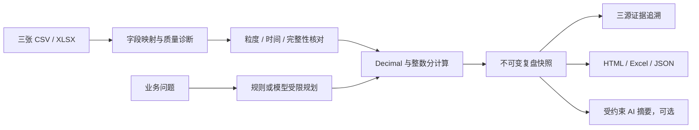

# 架构与设计

前端为原生 HTML/CSS/JavaScript，后端为 FastAPI。SQLite 保存来源元数据与结果快照，文件保存原件、规范化数据与诊断；SHA256 校验关联文件。金额使用 Decimal 逐行舍入到整数分再聚合，不让模型计算。

业务数据不全时保留未知状态；“确认已完整交接”是人工声明，不是系统能证明的事实。零目标不显示虚假的百分比达成率，重复唯一键不能无依据删除。订单按门店和订单号去重，不把小票行数当订单数。日运营记录只提供线索，不自动推导经营损失或因果。

报告保存为新快照，父记录不修改。同一父记录和相同正文生成相同保存标识，由数据库唯一键防止重试和同时提交造成副本；正文不同则保留不同版本。不提供多人共同编辑的最后写入胜出策略，也不等于企业级协作控制。

SQLite 事务不能把数据库和全部磁盘文件合成一个事务。导入落盘失败时不登记成功；可能遗留尚未登记的临时业务文件，维护核查会指出异常，不能将该能力称为任意中断下零残留。维护恢复写入全新目录，不覆盖原数据。升级/备份时应停止写入。

模型输入仅包含构造的分析上下文；普通模式使用者需自行授权数据传输。模型失败不会用假结果替代。离线模式忽略现有密钥、地址和模型配置，规则计算与预置静态材料均明确标注。

当前约束：单人本机使用；未提供身份隔离、多人协作、企业审计和真实业务长期验证。测试基于模拟业务与注入故障，不是任意未见样本的准确率保证。
